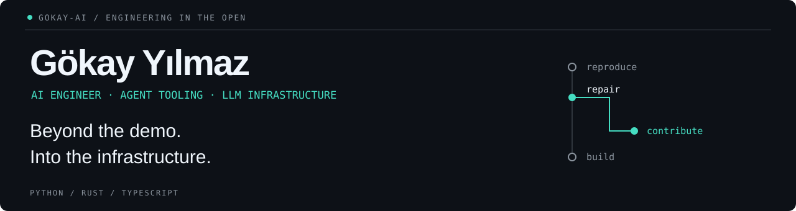

<picture>
  <source media="(max-width: 600px)" srcset="./assets/header-mobile.svg" />
  
</picture>

**I don't stop at using the AI stack. I build on it—and fix what breaks underneath.**

I'm Gökay, an AI engineer working across **LLM infrastructure, autonomous agents, and developer tools**. From fine-tuning and RAG at Halkbank to upstream fixes in open-source AI, I work where model capability meets engineering reality.

**Build the tool. Trace the failure. Ship the fix.**

[My projects](#building) · [Open-source work](#selected-open-source-contributions) · [X](https://x.com/gokayai) · [LinkedIn](https://www.linkedin.com/in/gokay-ai/)

## Selected open-source contributions

**Beyond the demo. Into the infrastructure.**  
Merged fixes across inference engines, model tooling, and the agents built on top.

Selected external AI projects · verified September 30, 2026 · excludes my own repositories and company projects. Hermes is counted separately.

### Inference & model infrastructure

**[vLLM](https://github.com/vllm-project/vllm) · Distributed inference**  
Fixed NIXL send-lease cleanup so a continuously heartbeated request cannot block reclamation of expired leases behind it.  
[KV-transfer lease reclamation ↗](https://github.com/vllm-project/vllm/pull/58292)

**[Hugging Face Hub](https://github.com/huggingface/huggingface_hub) · Cross-platform model tooling**  
Normalized cache revision paths on Windows to match Hub/API names and CLI filters.  
[Consistent cache refs ↗](https://github.com/huggingface/huggingface_hub/pull/4925)

**[Unsloth](https://github.com/unslothai/unsloth) · Training tooling**  
Repaired Studio's Linux installation fallback when distro `uv` policy blocks automatic Python downloads—without overriding system policy.  
[Linux installation recovery ↗](https://github.com/unslothai/unsloth/pull/9358)

### Agent runtimes & developer tools

**[OpenClaw](https://github.com/openclaw/openclaw) · Four merged fixes**  
Enabled compaction and retry for llama.cpp context overflows; repaired plugin-catalog refresh routing; distinguished local worker timeouts from provider errors; stopped internal runtime-publication failures from triggering unrelated provider failover and misleading quota warnings.  
[Context recovery ↗](https://github.com/openclaw/openclaw/pull/133888) · [Catalog routing ↗](https://github.com/openclaw/openclaw/pull/144740) · [Timeout attribution ↗](https://github.com/openclaw/openclaw/pull/155675) · [Failover classification ↗](https://github.com/openclaw/openclaw/pull/157218)

**[Goose](https://github.com/aaif-goose/goose) · Tool-calling compatibility**  
Set explicit non-strict tool schemas for Chat Completions to prevent upstream providers from filling optional fields and breaking delegation.  
[Provider compatibility ↗](https://github.com/aaif-goose/goose/pull/12272)

**[OpenHands](https://github.com/OpenHands/OpenHands) · Usable on smaller screens**  
Made Skills, Hooks, and Tools dialogs fit narrow viewports while preserving desktop sizing and keeping close controls reachable.  
[Responsive agent dialogs ↗](https://github.com/OpenHands/OpenHands/pull/17586)

**[LibreChat](https://github.com/LibreChat-AI/LibreChat) · Authentication reliability**  
Fixed non-string ban-cache keys that caused OAuth login failures when Redis was disabled.  
[OAuth / cache-key fix ↗](https://github.com/LibreChat-AI/LibreChat/pull/16039)

**[Cherry Studio](https://github.com/CherryHQ/cherry-studio) · Two merged fixes**  
Restored empty knowledge-base listings and prevented invalid UUID item IDs from breaking OpenAI Responses continuations, while preserving valid provider-issued IDs.  
[Knowledge-base validation ↗](https://github.com/CherryHQ/cherry-studio/pull/19874) · [Responses compatibility ↗](https://github.com/CherryHQ/cherry-studio/pull/20414)

### Incorporated upstream · authorship preserved

**[Hermes Agent · Nous Research](https://github.com/NousResearch/hermes-agent)**  
Fixed interrupted-update recovery so pending gateway fleet restarts complete on the next update run—even when Git already reports up to date. My original fix was cherry-picked into a maintainer's merged PR with authorship preserved; the original PR was not directly merged.  
[Original contribution ↗](https://github.com/NousResearch/hermes-agent/pull/95328) · [Merged upstream ↗](https://github.com/NousResearch/hermes-agent/pull/95980)

<strong>Still building · selected open pull requests</strong>

These are open contributions, not merged work. Status checked September 30, 2026.

- **[vLLM](https://github.com/vllm-project/vllm/pull/58570)** — INT8 MoE per-channel weight-scale indexing.
- **[SGLang](https://github.com/sgl-project/sglang/pull/40542)** — checkpoint dtype handling for KDA short-convolution weights.
- **[LiteLLM](https://github.com/BerriAI/litellm/pull/43818)** — preserving citation annotations through the streaming Responses bridge.
- **[MLX](https://github.com/ml-explore/mlx/pull/4584)** — Metal template-name handling for negative integer parameters.
- **[LMDeploy](https://github.com/InternLM/lmdeploy/pull/4985)** — including embedding content in prefix-cache identity.
- **[OpenHands](https://github.com/OpenHands/OpenHands/pull/17421)** — carrying enabled Canvas skills into Claude Code ACP sessions.
- **[Jan](https://github.com/janhq/jan/pull/8944)** — custom OpenAI-compatible providers without API keys.

[All open public PRs →](https://github.com/pulls?q=is%3Apr+author%3Agokay-ai+is%3Aopen+is%3Apublic)

[Explore merged PRs →](https://github.com/pulls?q=is%3Apr+author%3Agokay-ai+is%3Amerged+is%3Apublic) · [All public contributions →](https://github.com/pulls?q=is%3Apr+author%3Agokay-ai+is%3Apublic)

## Building

### [Sheep](https://github.com/gokay-ai/sheep) · Undo for AI coding agents

**Agents move fast. Developers should keep control.**

Turn-level checkpoints and worktree-scoped restores, written in **Rust**. Inspect the plan, rewind an agent's changes, and notify it of the restored state. Explicit previews. Scoped restores. Git metadata untouched.

[Source](https://github.com/gokay-ai/sheep) · [Releases](https://github.com/gokay-ai/sheep/releases) · [Architecture](https://github.com/gokay-ai/sheep/blob/main/docs/architecture.md)

### [Claude Code Sound Notifications](https://github.com/gokay-ai/claude-code-sound-notifications)

**Your agent finished. You should know.**

Native completion notifications for macOS and Linux through Claude Code's `Stop` hook. Built for terminal-heavy workflows, including Ghostty, tmux, and Zellij.

## Engineering focus

**Python · Rust · TypeScript · PyTorch · Docker · Linux**

LLM fine-tuning and RAG experience at **Halkbank**. Studying **Artificial Intelligence at the University of Birmingham**, graduating in 2027. Building toward agents with better memory, measurable behavior, and recoverable workflows.

---

**Building serious AI infrastructure or developer tools? Let's talk.**  
[X / @gokayai](https://x.com/gokayai) · [LinkedIn](https://www.linkedin.com/in/gokay-ai/)
